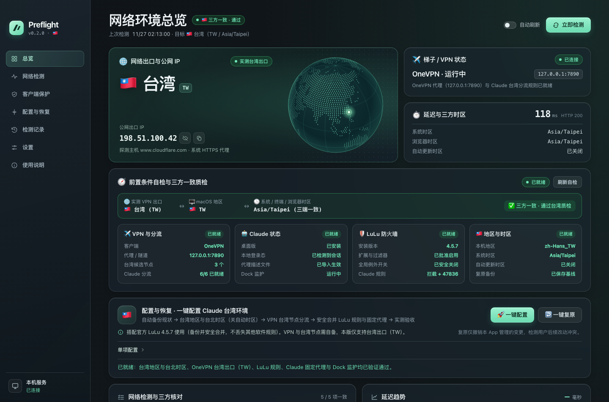

# Preflight

Preflight 是一款独立的 macOS 原生工具 App（搭配官方开源防火墙 **LuLu 4.5.7** 使用，不开发自有防火墙内核）。打开 Claude 前，可以在透明玻璃风格的 Mac 面板中查看网络出口国旗与公网 IP、自动检测本机 VPN 与前置条件，通过「一键配置」完成台湾环境配置与实测验收，并随时「一键复原」。

- **本版仅支持台湾出口（🇹🇼 `TW` / `Asia/Taipei`）**，其他国家或地区暂不支持。
- **VPN 与台湾节点需用户自备**，本 App 不提供任何 VPN 软件、订阅或节点。节点名称含台湾仅作为候选，必须经实测确认出口为 `TW` 才算通过。
- **目标平台**：macOS 13 或更新版本，Apple 芯片（`arm64`）与 Intel（`x86_64`）双架构通用构建，依赖本机 Python 3.9+。当前发行包为本地临时签名（ad-hoc），**未经 Apple 公证**。

**[下载 Preflight 0.2.0 for Mac](https://github.com/fxjcangku/claude-preflight/releases/download/v0.2.0/Preflight-0.2.0-macOS.zip)** · [项目介绍页](https://fxjcangku.github.io/claude-preflight/) · [发行说明](https://github.com/fxjcangku/claude-preflight/releases/tag/v0.2.0)



## 一键配置与一键复原范围

打开 Preflight Mac App 后，在「配置与恢复」点击 **「一键配置」**，App 会自动按顺序执行以下整套流程（只有在全部配置并逐项读回实测后才显示绿色成功）：

1. **首次配置前原子备份**：将当前 macOS 地区、系统时区、自动时区开关、待修改的 OneVPN 节点与分流规则，以及 LuLu 既有用户规则、Claude 代理描述文件和 Dock 监护状态保存至仅当前用户可读（`0600`）的基线备份中。重复点击或中断后重试始终沿用首次备份。
2. **台湾地区与台北时区**：设置 macOS 地区为台湾（`TW`）、系统时区为 `Asia/Taipei` 并关闭「自动更新时区」（经 macOS 管理员授权），完整保留当前简体中文界面和字体。
3. **VPN 台湾节点与 Claude 分流**：
   - 自动识别本机已安装的常见 macOS VPN / 代理客户端（OneVPN、Clash Verge、ClashX、Mihomo Party、Surge、WireGuard 等）与系统代理/TUN 隧道状态。
   - **针对 OneVPN 1.5.1**：自动执行三阶段安全流程——先锁定所有受管会话 → 正常退出 OneVPN → 重新读取最新 Flutter 偏好 → 保留全部用户订阅和其他规则，合并台湾候选节点与 Claude 6 个官方域名的 Clash 风格分流规则（`overrideData.rule.addedRules`）→ 正常重开 OneVPN → 等待代理和隧道就绪并实测 `TW` 出口（若首个候选节点实测非 `TW`，自动顺延尝试下一个台湾候选节点）。
   - **针对其他 VPN 客户端**：自动读取代理与隧道状态并实测确认台湾出口（`TW`）。
4. **LuLu 4.5.7 安全合并规则与 Claude 固定代理**：
   - 不直接覆盖 LuLu 规则集，也不丢失其他软件规则。
   - 若已有正确的 Claude 规则，直接复用且不冒充本 App 新增；若缺失，则先备份现有用户规则、计算所有无关规则指纹，生成仅包含用户规则（`type == 3`）的合并 JSON，经 LuLu 官方 `Rules → Import...`（触发 `userOnly=YES`，不触动 Apple/默认/基线规则）安全导入，导入后立即读回 `rules.plist` 核验原有规则零丢失且 Claude 规则生效（阻止 `/Applications/Claude.app/*` 其他全部出站，仅允许访问专用回环中继 `127.0.0.1:47836`）。
   - 若发现无法无损导入的临时 PID 规则或冲突放行规则，立即停止并说明，绝不冒险覆盖。
   - 核验并引导安装官方 `Claude-Preflight.mobileconfig` 固定代理描述文件（仅设置 `egressProxyUrl=http://127.0.0.1:47836`）。
5. **启用 Dock 启动监护并三方一致质检**：启动 Dock 监听服务并核对「实测 VPN 出口（`TW`）↔ macOS 地区（`TW`）↔ 系统/终端/浏览器时区（`Asia/Taipei`）」三方一致。

点击 **「一键复原」** 会按首次备份反向撤销本 App 所做的改动（停止受管转发 → 移除本 App 启用的 Dock 监护 → 仅移除本 App 新增的 LuLu 规则 → 按备份复原 OneVPN 偏好 → 复原 macOS 地区、时区及自动时区开关）。若某项在配置后已被用户自行修改，复原时会检测冲突、保留用户的修改并明确提示。

## 安装与首次系统授权

1. 下载并解压 `Preflight-0.2.0-macOS.zip`，将 `Preflight.app` 拖入「应用程序」文件夹。因当前版本为本地临时签名、未经 Apple 公证，首次打开如遇 Gatekeeper 提示，请在「系统设置 → 隐私与安全性」中点击「仍要打开」（或右键点击 App →「打开」）。
2. 自行安装官方 [LuLu 4.5.7](https://objective-see.org/products/lulu.html) 以及您自己的 VPN 客户端并导入含台湾节点的订阅。
3. 首次点击「一键配置」时，macOS 会按需请求以下系统确认（等待批准时面板显示黄色状态与具体指引，批准后再次点击「一键配置」即可从断点继续）：
   - **管理员密码**：用于设置系统时区 `Asia/Taipei` 及关闭自动更新时区。
   - **辅助功能权限**（仅当需自动合并导入 LuLu 规则时）：在「系统设置 → 隐私与安全性 → 辅助功能」勾选 Preflight，以便驱动 LuLu 官方导入界面。
   - **LuLu 网络扩展与过滤器**：首次安装 LuLu 时需在系统设置批准其系统扩展与套接字过滤器，并在 LuLu 设置中关闭回环、DNS、Allow List 和 Block Mode 全局例外。
   - **Claude 代理描述文件**：按提示在「系统设置 → 通用 → 设备管理」中安装「Claude Preflight」。

> 安全边界：系统配置原生桥仅在 Preflight Mac App 的本机主窗口中启用；在普通浏览器访问面板时，系统配置按钮保持禁用且无法调用原生桥。

## 断线保护与客户端监护

监测面板可独立使用，断线与节点切换保护覆盖三类客户端（均通过本机加密 CONNECT 中继转发，不解密 HTTPS）：

| 客户端 | 入口与保护方式 |
| --- | --- |
| 原生 Claude 桌面版 | 面板「受管桌面版」或 `./claude-preflight run --client desktop`，启用 Dock 监护后直接点击 Dock 图标亦可自动接管；配合 LuLu 仅放行 `127.0.0.1:47836`。 |
| 受管 Claude Code 终端 | `./claude-preflight run` 使用 macOS `sandbox-exec` 限制网络套接字，启动前实测允许中继、拒绝其他端口。 |
| 专用 Claude 网页窗口 | 面板「打开专用网页」或 `./claude-preflight run --client web` 打开独立 Chrome 资料夹，启动前实测代理失效时不会回退直连。 |

- **切换节点前**：点击面板「锁定受管连接」或运行 `./claude-preflight lock`，等待确认已锁定会话数后再切换。
- **超时暂停与不可逆锁定**：单次出口探测超时或失败时，中继会立即暂停全部转发，仅在经原 OneVPN 节点重新核验原出口 IP 后才恢复；手动锁定、确认节点改变、VPN 退出或出口改变后，旧会话将保持不可逆锁定。
- **轮询说明与重启要求**：出口与状态监测基于定时轮询，存在短暂检测间隔（非绝对零延迟）；锁定后旧客户端仍占用启动位置，**必须完全退出旧客户端后再重新启动**。

中继放行 Claude 官方服务域名，以及登录验证所需的 `challenges.cloudflare.com:443`、`hcaptcha.com` 及其子域、`accounts.google.com`、`www.gstatic.com`、`ssl.gstatic.com`；所有请求走同一受管中继，锁定时统一断开。

## 命令行与源码构建

需要 macOS 13+、Xcode Command Line Tools（构建 App）和 Python 3.9+（仅使用标准库）。

```sh
git clone https://github.com/fxjcangku/claude-preflight.git
cd claude-preflight
python3 -m unittest discover -s tests
bash macos/build-app.sh --zip
codesign --verify --strict dist/Preflight.app
lipo -archs dist/Preflight.app/Contents/MacOS/Preflight
```

常用终端命令：

```sh
./claude-preflight                # 启动本地监测面板
./claude-preflight check          # 命令行三方环境检测（TW / Asia/Taipei）
./claude-preflight readiness --json
./claude-preflight run            # 检测通过后受管启动 Claude Code CLI
./claude-preflight lock           # 切换节点前锁定所有受管会话
```

## 隐私说明

- 面板仅监听本机 `127.0.0.1`，无需登录，最近 60 次检测记录仅存内存、退出即清除。
- 备份文件均以仅当前用户可读权限（`0600`）存于 `~/Library/Application Support/Claude Preflight/`，不上传云端。
- 网络出口检测访问 `www.cloudflare.com/cdn-cgi/trace`（受管启动经代理访问 `claude.ai/cdn-cgi/trace`）。仓库、截图与发行包均仅使用 RFC 5737 示例 IP，不含任何真实订阅、凭证或公网 IP。

代码采用 [MIT 许可证](LICENSE)。地球图陆地数据来自公共领域的 [Natural Earth 1:110m](https://github.com/nvkelso/natural-earth-vector/blob/ca96624a56bd078437bca8184e78163e5039ad19/geojson/ne_110m_admin_0_countries.geojson)。
